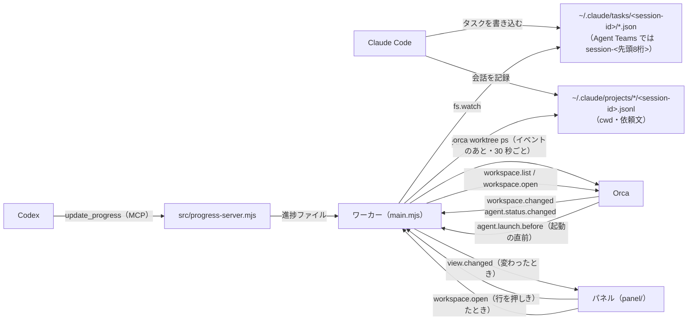

# orca-milestone

[Orca](https://github.com/stablyai/orca) の plugin です。フォーカス中のワークスペースで Claude Code や Codex が進めているタスクを、ゴールまでのマイルストーンとして右サイドバーに表示します。タスクが進むと、すぐに表示が変わります。

> [!WARNING]
> Orca の plugin 機能は Alpha です。この plugin は Orca 1.4.247 以上を対象にしています。

<p>
  
  
</p>

左が通常の表示、右がほかのワークスペースの行にマウスを乗せたときです（ワークスペース名やタスクはすべてダミーデータです）。

## できること

- **進捗を見る:** フォーカス中のワークスペースのゴールとタスク、完了数を表示します。ワークスペースを切り替えると、表示も切り替わります。
- **ほかのワークスペースを見る:** パネルの下端に、Claude Code・Codex が動いているほかのワークスペースを、入力や許可を待っているものから順に並べます。
- **詳しく見る:** 行にマウスを乗せると、その行が広がってゴールとタスクが出ます。
- **移動する:** 行を押すと、そのワークスペースへ移動します。

Claude Code と Codex に対応しています。

## 必要なもの

- Orca 1.4.247 以上（macOS のデスクトップアプリで確認）。1.4.246 以前は plugin を読み込めません。

Claude Code と Codex には、追加の設定は要りません。Orca のターミナルでエージェントを新しく起動すると、plugin が次を自動で行います。どちらも、そのセッションだけに効きます。

| エージェント | 起動時に行うこと |
|---|---|
| Claude Code | タスク用のツールを有効にし（`CLAUDE_CODE_ENABLE_TODO_TOOLS=1`）、ゴール付きのタスクで作業を記録するよう指示を足します（`--append-system-prompt`）。すでに `--append-system-prompt` を指定している起動には足しません。 |
| Codex | 進捗を記録する MCP ツール（`update_progress`）と、その使い方の指示を足します。Codex にはタスク一覧の機能がないためです。`~/.codex` の設定は変更しません。 |

保存したセッションの再開と Orca の外で起動したエージェントには、この処理は効きません。
- **Claude Code:** それらでも使うなら、`~/.claude/settings.json` と `~/.claude/CLAUDE.md` に次を加えます。

  ```json
  { "env": { "CLAUDE_CODE_ENABLE_TODO_TOOLS": "1" } }
  ```

  ```markdown
  - 作業を始めるときは TaskCreate で手順をタスクにし、どのタスクにも `metadata: {"goal": "<今の依頼で目指していることを 1 行で>"}` を付ける。
  - ゴールが変わったら、前のゴールの未完了タスクを completed か deleted にしてから、新しいゴールを付けたタスクを作る。
  ```

- **Codex:** 新しく起動し直してください。

## インストール

1. Orca の **設定 → プラグイン → ⋯ → カタログのソース…** で、次のカタログを追加します。Ref は `main` です。

   ```text
   https://github.com/andoshin11/orca-plugins
   ```

2. プラグインの一覧で Milestone を探して、**確認してインストール** を押します。
3. アクセスできる範囲を確かめて **インストールして有効化** を押し、公開元の確認でも **インストール** を押します。
4. 右サイドバーの旗アイコンを開きます。
5. Orca のターミナルで Claude Code か Codex を新しく起動します。すでに動いているセッションには、起動時の処理が効いていません。

**プラグインを追加 → Git URL から…** で `https://github.com/andoshin11/orca-milestone` を入れることもできます。ただし、この方法ではアップデートの機能が使えません。

### 承認する内容

Node のワーカーを動かすので、フルアクセスの plugin として承認します。そのほかに使うものは次のとおりです。

| 種類 | 内容 | 使い道 |
|---|---|---|
| 権限 `workspace:read` | ワークスペースの名前・ブランチなどの読み取り | 表示と移動先の特定 |
| 権限 `agent:read` | Agent ステータスの通知 | 表示の更新 |
| 権限 `workspace:write` | ワークスペースを開く、組み込みコマンドを実行する | 行を押したときの移動（これにしか使いません） |
| フック `agent.launch.before` | エージェントの起動直前の処理 | [起動時の設定](#必要なもの) |

### 更新

カタログから入れた場合は、Orca の **プラグインを自動でアップデート**（既定でオン）により、自動で更新されます。新しい権限が増えるときは、確認を求められます。

手動で更新するには、プラグインの一覧の **アップデート** タブか Milestone のページで、**アップデート** を押します。出ないときは、一覧の更新ボタンを押してカタログを読み直してください。

- Git URL から入れた場合は、更新の機能が使えません。同じ URL でインストールし直して、**プラグインを有効にする** をもう一度押します。
- 動いているセッションには、起動時の処理の変更は効きません。新しく起動し直してください。

### アンインストール

プラグインの一覧で Milestone を開き、右上の **⋯** から **削除…** を選びます。Codex の進捗ファイルを置く `~/.orca-milestone/` は残るので、不要なら削除してください。

## 表示されないとき

- パネルに「このワークスペースのエージェントはまだタスクを作っていません」と出る場合、エージェントがタスクを記録していません。記録するかどうかはエージェントが作業の大きさで決めるため、短い作業では記録しないこともあります。進捗を出したいときは「タスクに分けて進めて」と頼みます。
- plugin を入れる前や更新の前から動いているセッションは、起動時の処理が効いていません。新しく起動し直してください。
- Codex の場合は、`~/.orca-milestone/progress/` に進捗ファイルができているかを確かめます。ファイルがなければ、Codex に `update_progress` ツールがあるか尋ねてください。

### 知っておきたい制約

- Codex の指示は `developer_instructions` として渡します。`~/.codex/config.toml` に同じ設定があると、Orca から起動したセッションではこの plugin の指示に置き換わります。
- `update_progress` は、Codex の承認なしで動きます。書き込むのは `~/.orca-milestone/progress/` の進捗ファイルだけで、セッションが終わると消えます。
- 確認したのは、ローカルの macOS でターミナルとして起動した場合です。チャット表示での起動と SSH 先のワークスペースは確認していません。

## 表示の細かいルール

- フォーカス中のワークスペースは、セッションごとに新しい順で最大 3 件、ほかのワークスペースは最大 8 件を表示します。
- ゴールは、Codex では記録されたものを使います。Claude では次の順で決めます。
  1. Claude がタスクに書いたゴール（`metadata.goal`）。いちばん新しいタスクのものを使い、ほかのゴールのタスクは表示しません。
  2. 一覧の最初のタスクを作る直前に送った依頼文
  3. セッションの最初の依頼文
- ほかのワークスペースは、要確認（入力待ち・許可待ち）のもの、タスクが残っているもの、すべて完了したものの順に並びます。後の 2 つは、タスクが新しく動いた順です。「作業中」はターンごとに変わるので、並びには影響しません。
- 行の印は、オレンジの点が要確認か実行中のタスクあり、緑のチェックがすべて完了、グレーの点がそれ以外です。
- 広げた行の長い一覧はスクロールでき、未完了のタスクの位置から表示します。名前の行の上でホイールを回しても動きます。タスクが 9 件以上の行は、広がった部分へマウスを入れられます。
- 行はキーボードで選んで、Enter か Space でも移動できます。
- タスク一覧は、そのセッションが動いている間だけ表示します。動いているセッションは、Claude は `~/.claude/sessions/<pid>.json` に書かれる情報で、Codex はプロセスが動いているかで判断します。
- Claude はすべてのタスクを完了するとタスク一覧のファイルを消しますが、セッションが動いている間は完了した状態のまま表示を残します。plugin を再起動した後も、transcript に残る TaskCreate / TaskUpdate の記録から組み立て直します。
- Orca の Agent Teams で起動した Claude（`claude --teammate-mode`）にも対応しています。

## 仕組み



- パネルの HTML・CSS・スクリプトは `panel/` に置いた固定のファイルです。表示する本文はワーカーが作り、パネルは Orca の通信路（`orca.plugin.request` / `orca.plugin.on`）で受け取ります。
- パネルは受け取った本文との差分だけを DOM に反映します。更新してもパネルは作り直されないので、ちらつかず、スクロール位置や広がった行も保たれます。
- タスクが完了すると、進捗バーが伸び、色が変わり、取り消し線が左から右へ引かれます。ワークスペースやゴールが変わったときは、別の一覧として動きなしで切り替えます。OS の視差効果を減らす設定では動きません。
- ワーカーは内容が変わったときだけ本文を送ります。パネルを開いたとき（サイドバーのタブを切り替えて戻ったときを含む）は、その時点の本文を取りに行きます。
- Agent Teams を率いる Claude は、タスク一覧をチーム名（`session-<セッション ID の先頭 8 桁>`）のフォルダーに書きます。どのセッションのものかは、`~/.claude/teams/<チーム名>/config.json` のリーダーのセッション ID か、なければ先頭 8 桁が一致する transcript で決めます。
- フォーカス中のワークスペースのパスは、`workspace.readContext` が返さないため、Orca に同梱の CLI（`orca worktree ps`）で調べます。セッションは、transcript に記録された作業ディレクトリがそのパスの中にあるものを表示します。
- フォーカスの移動は `workspace.changed`、どのワークスペースの Agent の変化も `agent.status.changed` で知り、そのときだけ `orca worktree ps` で取り直します（1 回 0.1〜0.2 秒）。イベントで分からない変化（イベントなしに終わったセッションなど）のために、30 秒ごとにも取り直します。
- Orca は 5 分間やりとりのないワーカーを止めるため、パネルは開いている間、1 分ごとに本文を取りに行きます。パネルを閉じているとワーカーは止まることがあり、次にパネルを開いたときかイベントが届いたときに起動します。
- Codex の MCP サーバーは、Orca 自身のバイナリを Node として動かすので、Node のインストールは要りません。Codex のセッションごとに 1 つ起動し、親である Codex のプロセス ID を付けたファイルに進捗を書きます。ワーカーはそのプロセスが終わるとファイルを消します。

## 開発

clone したフォルダーを開発フォルダーとして読み込むと、変更がすぐ反映されます。同じ plugin をインストールしていても、開発フォルダーのほうが優先されます。

```sh
git clone https://github.com/andoshin11/orca-milestone.git
orca plugin dev load /path/to/orca-milestone   # 承認が必要なときは、内容を確かめて --approve <fingerprint> を付けて実行し直す
orca plugin dev unload /path/to/orca-milestone # 外す
```

テストと manifest の検証は次のとおりです。

```sh
npm ci
npm test

# Orca 本体の parser で orca-plugin.json を検証する（stablyai/orca の checkout が必要）
ORCA_SOURCE_DIR=/path/to/orca npm run check:manifest
```

README のスクリーンショットは、ダミーデータでパネルを描いたページから撮っています。

```sh
node scripts/render-sample.mjs /tmp/sample.html          # 通常の表示
node scripts/render-sample.mjs /tmp/sample-hover.html --hover   # 行にマウスを乗せたとき
```

ワーカーのコードを変えたら、Settings → Plugins で Milestone をいったんオフにしてからオンに戻すと、新しいコードで起動します。CI では `engines.orca` に対応する Orca のタグ（v1.4.247）を取得して、manifest を検証します。

### リリース

1. バージョンを上げて main にマージし、タグと GitHub Release を公開します。
2. [andoshin11/orca-plugins](https://github.com/andoshin11/orca-plugins) の手順に従い、タグのコミットで `orca plugin release-entry` を実行して、`orca-catalog.json` の `releases` の先頭に足します。

## ライセンス

[MIT](LICENSE)
