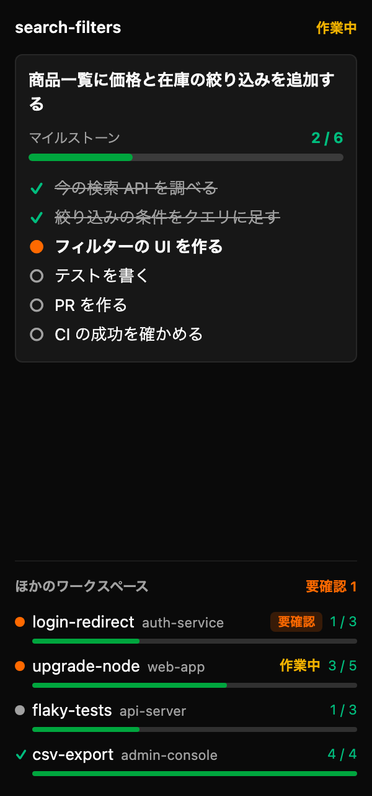
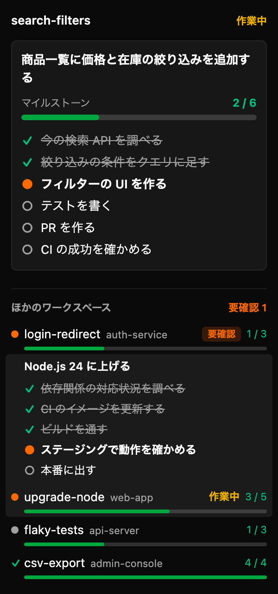
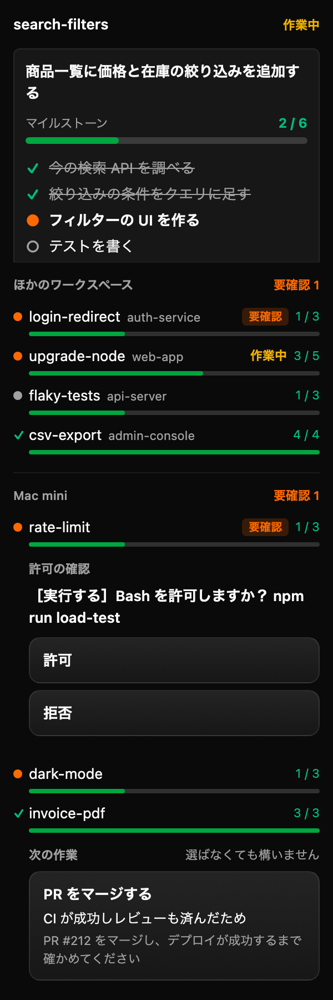
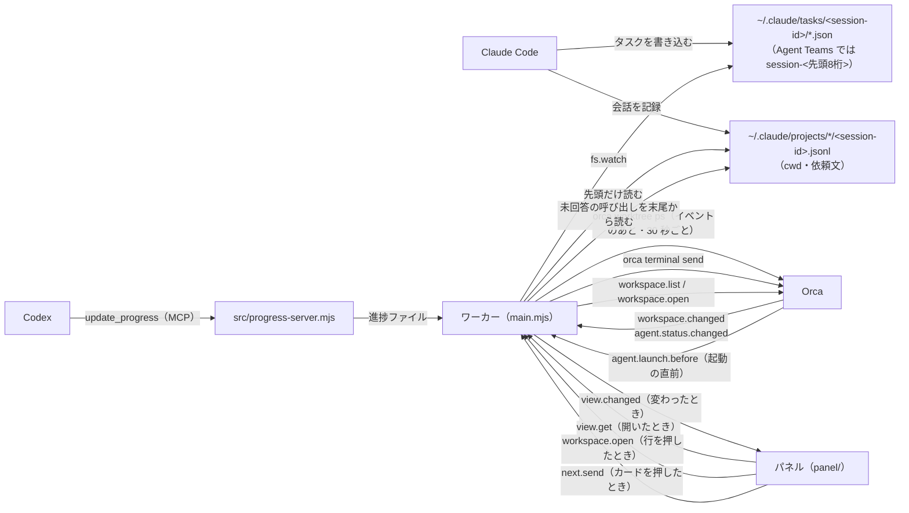

# orca-milestone

[Orca](https://github.com/stablyai/orca) の plugin です。フォーカス中のワークスペースで Claude Code や Codex が進めているタスクを、ゴールまでのマイルストーンとして右サイドバーに表示します。タスクが進むと、すぐに表示が変わります。

> [!WARNING]
> Orca の plugin 機能は Alpha です。この plugin は Orca 1.4.247 以上を対象にしています。

<p>
  
  
</p>

左が通常の表示、右がほかのワークスペースの行にマウスを乗せたときです（ワークスペース名やタスクはすべてダミーデータです）。

## できること

- **進捗を見る:** フォーカス中のワークスペースのゴールとタスク、完了数を表示します。ワークスペースを切り替えると、表示も切り替わります。
- **ほかのワークスペースを見る:** パネルの下端に、Claude Code・Codex が動いているほかのワークスペースを、入力や許可を待っているものから順に並べます。
- **詳しく見る:** 行にマウスを乗せると、その行が広がってゴールとタスクが出ます。
- **移動する:** 行を押すと、そのワークスペースへ移動します。
- **次の作業を頼む:** フォーカス中のワークスペースのエージェントが回答の最後に書いた次の候補を、カードとして縦に並べます。押すと、その依頼文をエージェントに送ります。
- **質問と許可に答える:** Claude Code の質問（AskUserQuestion）にカードで答えられます。複数の質問や複数選択は、選んでから「回答を送信」を押します。ツールの許可待ちは「許可」（今回だけ）と「拒否」のカードで答えられます（Codex は「拒否」の代わりに「中止」）。
- **別の Mac のセッションを見る:** エージェントを別の Mac で動かし、この Mac の Orca をクライアントとして使う場合に、その Mac の [agent-status-panel](https://github.com/andoshin11/agent-status-panel) の daemon からセッションを読み、パネルの一番下に並べます。その Mac のワークスペースを開くと、カードを上に出し、押すとその Mac のエージェントに送ります。[別の Mac のセッションを出す](#別の-mac-のセッションを出す)を参照してください。

- **Orca の bot とチャットも見る:** Orca の bot や、チャットとして起動したエージェントも、進捗をほかのワークスペースと同じように出します。bot の行には `bot` の印を付けます。カードは見るだけで、答えるのは Orca のチャットです。[Orca の bot とチャット](#orca-の-bot-とチャット)を参照してください。

Claude Code と Codex に対応しています。

## 必要なもの

- Orca 1.4.247 以上（macOS のデスクトップアプリで確認）。1.4.246 以前は plugin を読み込めません。

Claude Code と Codex には、追加の設定は要りません。Orca のターミナルでエージェントを新しく起動すると、plugin が次を自動で行います。どちらも、そのセッションだけに効きます。

| エージェント | 起動時に行うこと |
|---|---|
| Claude Code | タスク用のツールを有効にし（`CLAUDE_CODE_ENABLE_TODO_TOOLS=1`）、ゴール付きのタスクで作業を記録するよう指示を足します（`--append-system-prompt`）。Orca の Agent Teams での起動（`orca claude-teams`）も同じです。すでに `--append-system-prompt` を指定している起動には足しません。 |
| Codex | 進捗を記録する MCP ツール（`update_progress`）と、その使い方の指示を足します。Codex にはタスク一覧の機能がないためです。`~/.codex` の設定は変更しません。 |

どちらのエージェントにも、作業を終えたら次にやることの候補を回答の最後に書くよう指示します。[agent-status-panel](https://github.com/andoshin11/agent-status-panel) がこれを iPhone のボタンにします。

保存したセッションの再開と Orca の外で起動したエージェントには、この処理は効きません。
- **Claude Code:** それらでも使うなら、`~/.claude/settings.json` と `~/.claude/CLAUDE.md` に次を加えます。

  ```json
  { "env": { "CLAUDE_CODE_ENABLE_TODO_TOOLS": "1" } }
  ```

  ```markdown
  - 作業を始めるときは TaskCreate で手順をタスクにし、どのタスクにも `metadata: {"goal": "<今の依頼で目指していることを 1 行で>"}` を付ける。
  - ゴールが変わったら、前のゴールの未完了タスクを completed か deleted にしてから、新しいゴールを付けたタスクを作る。
  ```

- **Codex:** 新しく起動し直してください。

## インストール

1. Orca の **設定 → プラグイン → ⋯ → カタログのソース…** で、次のカタログを追加します。Ref は `main` です。

   ```text
   https://github.com/andoshin11/orca-plugins
   ```

2. プラグインの一覧で Milestone を探して、**確認してインストール** を押します。
3. アクセスできる範囲を確かめて **インストールして有効化** を押し、公開元の確認でも **インストール** を押します。
4. 右サイドバーの旗アイコンを開きます。
5. Orca のターミナルで Claude Code か Codex を新しく起動します。すでに動いているセッションには、起動時の処理が効いていません。

**プラグインを追加 → Git URL から…** で `https://github.com/andoshin11/orca-milestone` を入れることもできます。ただし、この方法ではアップデートの機能が使えません。

### 承認する内容

Node のワーカーを動かすので、フルアクセスの plugin として承認します。そのほかに使うものは次のとおりです。

| 種類 | 内容 | 使い道 |
|---|---|---|
| 権限 `workspace:read` | ワークスペースの名前・ブランチなどの読み取り | 表示と移動先の特定 |
| 権限 `agent:read` | Agent ステータスの通知 | 表示の更新 |
| 権限 `workspace:write` | ワークスペースを開く、組み込みコマンドを実行する | 行を押したときの移動（これにしか使いません） |
| フック `agent.launch.before` | エージェントの起動直前の処理 | [起動時の設定](#必要なもの) |
| 権限 `settings:own` | この plugin の設定の読み取り | [別の Mac の接続先](#別の-mac-のセッションを出す) |

カードを押したときは、Orca に同梱の CLI（`orca terminal send`）で、そのエージェントのターミナルに依頼文やキーを送ります。権限の対象ではなく、ワーカーが CLI を実行して行います。

### 更新

カタログから入れた場合は、Orca の **プラグインを自動でアップデート**（既定でオン）により、自動で更新されます。新しい権限が増えるときは、確認を求められます。

手動で更新するには、プラグインの一覧の **アップデート** タブか Milestone のページで、**アップデート** を押します。出ないときは、一覧の更新ボタンを押してカタログを読み直してください。

- Git URL から入れた場合は、更新の機能が使えません。同じ URL でインストールし直して、**プラグインを有効にする** をもう一度押します。
- 動いているセッションには、起動時の処理の変更は効きません。新しく起動し直してください。

### アンインストール

プラグインの一覧で Milestone を開き、右上の **⋯** から **削除…** を選びます。Codex の進捗ファイルを置く `~/.orca-milestone/` は残るので、不要なら削除してください。

## 別の Mac のセッションを出す

エージェントを常に動かしている Mac（例: Mac mini）と、普段使う Mac（例: MacBook Pro）が別のときに使います。設定するのは、普段使う Mac の Orca だけです。

1. エージェントを動かす Mac で [agent-status-panel](https://github.com/andoshin11/agent-status-panel) の daemon を動かし、`tailscale serve` で tailnet に公開します（iPhone アプリと同じ準備です。Funnel は使いません）。ボタンを押すには、daemon の `allowedLogin` に自分の Tailscale のログインを設定します。
2. 普段使う Mac の Orca で、**Settings → Plugins → Milestone** を開き、次を入れます。
   - **Remote agent-status-panel**: daemon の tailnet のホスト名（`mac-mini.example.ts.net` など）か、`https://` の URL
   - **Remote name**: パネルの見出し（既定は `Mac mini`）

パネルの一番下に、その Mac のセッションが、入力や許可を待っているものから順に並びます。10 秒ごとに読み直します。

- 一覧の行は、この Mac のほかのワークスペースと同じく、ポインターを載せるとゴールとタスクを広げます。
- 質問・許可・次の作業のカードは、次のようにその Mac のワークスペースを開いたときに上に出ます。押すと daemon の `POST /next` に送り、daemon がその Mac のエージェントに伝えます。
- daemon は、`tailscale serve` が付けるログイン名で押した人を確かめます。普段使う Mac も同じ Tailscale のログインでつないでください。
- Orca の「Remote Orca Servers」でその Mac とペアリングし、その Mac のワークスペースを開くと、そのワークスペースのセッションのゴール・タスク・カードをパネルの上に大きく出します。その Mac のほかのセッションは、これまでどおり下に並びます。
  - Orca が plugin に渡すワークスペースの ID からその Mac 上のパスを取り出し、daemon が `status.json` に書くパスのハッシュ（`place`）と突き合わせます。`place` を書かない古い daemon では、上には出ません。
  - エージェントをワークスペースのサブフォルダーで起動したセッションは、パスが合わないので上には出ません。
- 出るのは daemon の `status.json` にある情報だけです。ワークスペースへの移動と「最新の指示で再開」のカードはありません。
- ホスト名は Orca の設定にだけ保存されます。



## Orca の bot とチャット

Orca の bot（`~/.orca/bots/<名前>` に住むエージェント）と、チャットとして起動したエージェントは、端末ではなく Orca のチャットで動きます。Claude Code はユーザー設定（`~/.claude/CLAUDE.md` など）を読んで動くので、タスクを記録するよう `CLAUDE.md` に書いておけば、ほかのワークスペースと同じように進捗が出ます。

- **進捗:** bot のページを開くと、パネルの上にその bot のゴールとタスクが出ます。ほかを見ているときは、ほかのワークスペースに並び、名前の横に `bot` の印が付きます。タスク一覧は、ほかと同じく Claude のプロセスが動いている間だけ出ます。Orca はチャットの Claude をターンの合間に止めることがあり、そのときは一覧も消えます。
- **カード:** 次の作業・質問・許可のカードを、点線の枠で、押せない形で出します。チャットには押すための端末がなく、Orca も外からチャットに送る方法を用意していないためです。答えるのは Orca のチャットです。「このターンの残りも許可」と「最新の指示で再開」は出しません。
- **次の作業の読み方:** Orca はチャットのエージェントの最後の回答を先頭の 200 文字ほどしか返さず、末尾の `next` のブロックが切れます。そのため、開いているワークスペースに限り、そのフォルダーの新しい transcript（30 件まで）から、Orca が返す先頭と一致する回答を探して全文を読みます。bot のフォルダーには定期実行の transcript も並ぶので、先頭が一致しないものは使いません。一致するものがなければカードは出しません。
- **出す条件:** ワークスペースに端末のエージェントがなく、チャットのエージェントが 1 つだけのときです。チャットが 2 つ以上あると、どれのカードか決められないため出しません。
- Orca の bot と Claude Code（Orca 1.4.269）で確認しました。Codex のチャットは、進捗だけが出ます。

## 表示されないとき

- パネルに「このワークスペースのエージェントはまだタスクを作っていません」と出る場合、エージェントがタスクを記録していません。記録するかどうかはエージェントが作業の大きさで決めるため、短い作業では記録しないこともあります。進捗を出したいときは「タスクに分けて進めて」と頼みます。
- plugin を入れる前や更新の前から動いているセッションは、起動時の処理が効いていません。新しく起動し直してください。
- Codex の場合は、`~/.orca-milestone/progress/` に進捗ファイルができているかを確かめます。ファイルがなければ、Codex に `update_progress` ツールがあるか尋ねてください。
- 別の Mac のセッションに「つながりません」と出る場合は、両方の Mac が Tailscale につながっているか、設定のホスト名が合っているかを確かめます。Mac を再起動したあとは、Tailscale をオフにしてオンに戻すと直ることがあります。

### 知っておきたい制約

- Codex の指示は `developer_instructions` として渡します。`~/.codex/config.toml` に同じ設定があると、Orca から起動したセッションではこの plugin の指示に置き換わります。
- `update_progress` は、Codex の承認なしで動きます。書き込むのは `~/.orca-milestone/progress/` の進捗ファイルだけで、セッションが終わると消えます。
- 確認したのは、ローカルの macOS でターミナルとして起動した場合と、Orca の bot です。SSH 先のワークスペースは確認していません。

## 表示の細かいルール

- フォーカス中のワークスペースは、セッションごとに新しい順で最大 3 件、ほかのワークスペースは最大 8 件を表示します。
- ゴールは、Codex では記録されたものを使います。Claude では次の順で決めます。
  1. Claude がタスクに書いたゴール（`metadata.goal`）。いちばん新しいタスクのものを使い、ほかのゴールのタスクは表示しません。
  2. 一覧の最初のタスクを作る直前に送った依頼文
  3. セッションの最初の依頼文
- ほかのワークスペースは、要確認（入力待ち・許可待ち）のもの、タスクが残っているもの、すべて完了したものの順に並びます。後の 2 つは、タスクが新しく動いた順です。「作業中」はターンごとに変わるので、並びには影響しません。
- Orca は、Claude Code が裏で動かしているシェルがあると、ターンを終えて入力を待っていても「作業中」と返します。そのため、Orca が作業中と返す Claude は transcript の末尾を読み、最後のターンの後に `turn_duration` があってその後にプロンプトやツールの結果がなければ、「待機中（裏で実行中）」と表示します（ほかのワークスペースの行は「裏で実行中」）。提案のカードも、待機中のときと同じように出ます。
- 行の印は、オレンジの点が要確認か実行中のタスクあり、緑のチェックがすべて完了、グレーの点がそれ以外です。
- 広げた行の長い一覧はスクロールでき、未完了のタスクの位置から表示します。名前の行の上でホイールを回しても動きます。タスクが 9 件以上の行は、広がった部分へマウスを入れられます。
- 行はキーボードで選んで、Enter か Space でも移動できます。
- タスク一覧は、そのセッションが動いている間だけ表示します。動いているセッションは、Claude は `~/.claude/sessions/<pid>.json` に書かれる情報で、Codex はプロセスが動いているかで判断します。
- Claude はすべてのタスクを完了するとタスク一覧のファイルを消しますが、セッションが動いている間は完了した状態のまま表示を残します。plugin を再起動した後も、transcript に残る TaskCreate / TaskUpdate の記録から組み立て直します。
- Orca の Agent Teams で起動した Claude（`claude --teammate-mode`）にも対応しています。
- 次の作業のカードは、ワークスペースに動いているメインのエージェントが 1 つだけで、ターンを終えて（`done`）いて、回答の最後に `next` のコードブロックがあるときに出ます。候補は 3 つまで、各カードに見出し（`label`）、勧める理由（`reason`、あれば）、送られる依頼文（`prompt`）を出します。
- カードを押したときに送るのはカードの ID と番号だけで、依頼文はワーカーがその時点の回答から読み直します。前のターンのカードや、2 度目の押下は何も送りません。
- Claude Code の入力欄に書きかけの文字があるときは、送る前に Ctrl+S で退避し、送ったあとに戻します。Codex には退避の機能がないので、入力欄に文字があれば送らず、カードの下に理由を出します。
- 質問のカードは、Claude Code が AskUserQuestion で止まっているときに、transcript の未回答の呼び出しから作ります。1 問だけの単一選択は、押すとその番号のキーを送ってすぐ答えます。それ以外はフォームになり、「回答を送信」で番号のキー（複数選択は選んだ番号のあと Tab）を順に送り、確認のページが出たことを画面で確かめてから Enter で送ります。選択肢は 9 個まで、質問は 4 問までです。
- 許可のカードは、Claude Code では transcript の未回答の呼び出し、Codex では画面に出ているメニューから作ります。Claude Code が 1 つのターンで複数の呼び出しを出して許可を待っている間は、transcript にまだ書かれていないため、シェルのコマンドに限り、Orca が返すコマンドと画面のメニューが一致するときにカードを出します。Codex はシェルのコマンドとファイルの編集だけが対象です。押す直前に画面を読み、その呼び出しのメニューが出ているときだけ、許可は `1`、拒否は Esc を送ります。「今後は聞かない」やモードの切り替えの選択肢は押しません。Codex の Esc はターン全体を止めるので、カードの名前は「中止」です。
- `rm`、`sudo`、`git push --force` などの危険なコマンドの許可は、1 度目に押すと確認の表示になり、もう一度押したときに送ります。判定はパターンの照合で、すべての危険な操作は見分けられません。
- 許可のカードの見出しには、呼び出しの種類を「読むだけ」「書き換える」「外に出る」で出します（危険なコマンドは「危険なコマンド」）。シェルのコマンドは、すべての部分が読むだけと分かるときだけ「読むだけ」で、知らないコマンドは「書き換える」とみなします。「外に出る」は `git push`、`gh pr create`、データを送る `curl`、`kubectl`、`aws`、DB クライアント、送信する MCP ツールなど、この Mac の外に届くものです。コマンドを実行する場所がワークスペースの直下でないときは、`場所: apps/web` のように添えます。判定は agent-status-panel の iPhone のカードと同じです。
- 新しく出たカードは、1.5 秒の間は薄く表示して押下を受け付けません。許可に答えると次の許可のカードが同じ場所に出るので、続けて押して読まないまま答えることを防ぐためです。
- 許可のカードには「このターンの残りも許可」もあります。押すと今回の呼び出しを許可し、同じターンの残りの呼び出しのうち「読むだけ」「書き換える」のものを、カードを出さずに自動で許可します。Claude Code は並列の呼び出しを 1 件ずつしか見せないため、先に全部を並べられないからです。「外に出る」ものと危険なコマンドは対象外で、ふだんどおりカードが出ます。自動で許可したものは、カードの下に「このターンでまとめて許可したもの」として並べます。
  - 仕組み: launch hook が Claude に `--settings` で PermissionRequest フック（`src/permission-hook.mjs`）を付けます。押したときに `~/.local/state/orca-milestone/grants/<session>.json` に許可の範囲を書き、フックがそれを読んで許可を返します。範囲はそのターンのプロンプトに結び付き、次のプロンプトか 1 時間で消えます。範囲がなければフックは何も返さず、Claude Code がふだんどおり聞きます。
  - フックのない、以前に起動したセッションには、このカードは出ません。「最新の指示で再開」で起動し直すと出るようになります。
- 開いているワークスペースの Claude が、今の plugin より古い指示で動いているときは、次の作業のカードの最後に「最新の指示で再開」を出します。古いかどうかは、Claude のプロセスの起動引数に今の指示が含まれているかで決めます（plugin の更新前や Orca の外で起動したセッション）。押すと、入力欄が空か（灰色の候補だけでもよい）を画面と Orca の端末ログで確かめてから `/exit` を送り、同じ会話のまま `--resume` で起動し直します。シェルから起動したセッションは同じターミナルで、Orca が起動したセッション（Agent Teams など）は同じ名前の新しいターミナルで起動します。`--dangerously-skip-permissions`、`--permission-mode`、`--model` と Orca の `--plugin-dir` は引き継ぎます。入力欄に書きかけの文字があるとき、裏でシェルが動いているとき（`/exit` で止まるため）は、カードを出さないか、再開しません。

## 仕組み



- パネルの HTML・CSS・スクリプトは `panel/` に置いた固定のファイルです。表示する本文はワーカーが作り、パネルは Orca の通信路（`orca.plugin.request` / `orca.plugin.on`）で受け取ります。
- パネルは受け取った本文との差分だけを DOM に反映します。更新してもパネルは作り直されないので、ちらつかず、スクロール位置や広がった行も保たれます。
- タスクが完了すると、進捗バーが伸び、色が変わり、取り消し線が左から右へ引かれます。ワークスペースやゴールが変わったときは、別の一覧として動きなしで切り替えます。OS の視差効果を減らす設定では動きません。
- ワーカーは内容が変わったときだけ本文を送ります。パネルを開いたとき（サイドバーのタブを切り替えて戻ったときを含む）は、その時点の本文を取りに行きます。
- Agent Teams を率いる Claude は、タスク一覧をチーム名（`session-<セッション ID の先頭 8 桁>`）のフォルダーに書きます。どのセッションのものかは、`~/.claude/teams/<チーム名>/config.json` のリーダーのセッション ID か、なければ先頭 8 桁が一致する transcript で決めます。
- 質問と許可のカードのために、エージェントが入力や許可を待っているときだけ、Claude の transcript の末尾（1 MB まで）を読みます。Codex の許可は、そのペインの画面を `orca terminal read` で読みます。
- 次の作業のカードは、`orca worktree ps` が返すエージェントの最後の回答から、`next` のコードブロックだけを取り出して作ります。それ以外の依頼文と回答は使いません。ブロックの規則は [agent-status-panel](https://github.com/andoshin11/agent-status-panel) と同じです。
- フォーカス中のワークスペースのパスは、`workspace.readContext` が返さないため、Orca に同梱の CLI（`orca worktree ps`）で調べます。セッションは、transcript に記録された作業ディレクトリがそのパスの中にあるものを表示します。
- フォーカスの移動は `workspace.changed`、どのワークスペースの Agent の変化も `agent.status.changed` で知り、そのときだけ `orca worktree ps` で取り直します（1 回 0.1〜0.2 秒）。イベントで分からない変化（イベントなしに終わったセッションなど）のために、30 秒ごとにも取り直します。
- Orca は 5 分間やりとりのないワーカーを止めるため、パネルは開いている間、1 分ごとに本文を取りに行きます。パネルを閉じているとワーカーは止まることがあり、次にパネルを開いたときかイベントが届いたときに起動します。
- Codex の MCP サーバーは、Orca 自身のバイナリを Node として動かすので、Node のインストールは要りません。Codex のセッションごとに 1 つ起動し、親である Codex のプロセス ID を付けたファイルに進捗を書きます。ワーカーはそのプロセスが終わるとファイルを消します。

## 開発

clone したフォルダーを開発フォルダーとして読み込むと、変更がすぐ反映されます。同じ plugin をインストールしていても、開発フォルダーのほうが優先されます。

```sh
git clone https://github.com/andoshin11/orca-milestone.git
orca plugin dev load /path/to/orca-milestone   # 承認が必要なときは、内容を確かめて --approve <fingerprint> を付けて実行し直す
orca plugin dev unload /path/to/orca-milestone # 外す
```

テストと manifest の検証は次のとおりです。

```sh
npm ci
npm test

# Orca 本体の parser で orca-plugin.json を検証する（stablyai/orca の checkout が必要）
ORCA_SOURCE_DIR=/path/to/orca npm run check:manifest
```

README のスクリーンショットは、ダミーデータでパネルを描いたページから撮っています。

```sh
node scripts/render-sample.mjs /tmp/sample.html          # 通常の表示
node scripts/render-sample.mjs /tmp/sample-hover.html --hover   # 行にマウスを乗せたとき
node scripts/render-sample.mjs /tmp/sample-next.html --next     # 作業を終え、次の作業のカードが出たとき（docs/images/panel-next.png）
node scripts/render-sample.mjs /tmp/sample-remote.html --remote # 別の Mac のセッションを足したとき（docs/images/panel-remote.png）
```

ワーカーのコードを変えたら、Settings → Plugins で Milestone をいったんオフにしてからオンに戻すと、新しいコードで起動します。CI では `engines.orca` に対応する Orca のタグ（v1.4.247）を取得して、manifest を検証します。

### リリース

1. バージョンを上げて main にマージし、タグと GitHub Release を公開します。
2. [andoshin11/orca-plugins](https://github.com/andoshin11/orca-plugins) の手順に従い、タグのコミットで `orca plugin release-entry` を実行して、`orca-catalog.json` の `releases` の先頭に足します。

## ライセンス

[MIT](LICENSE)
