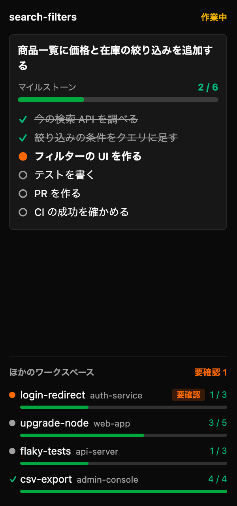
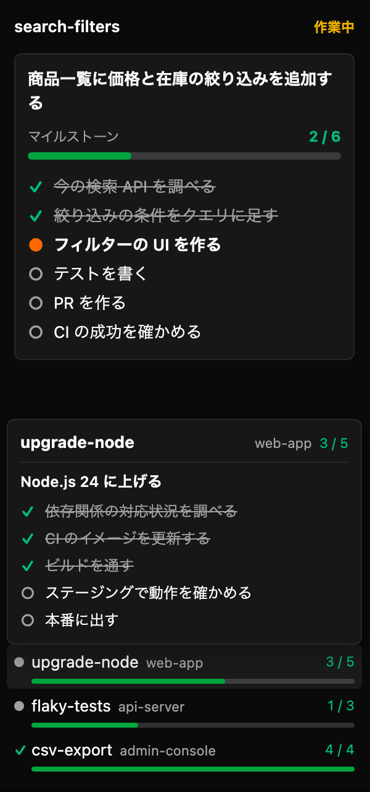
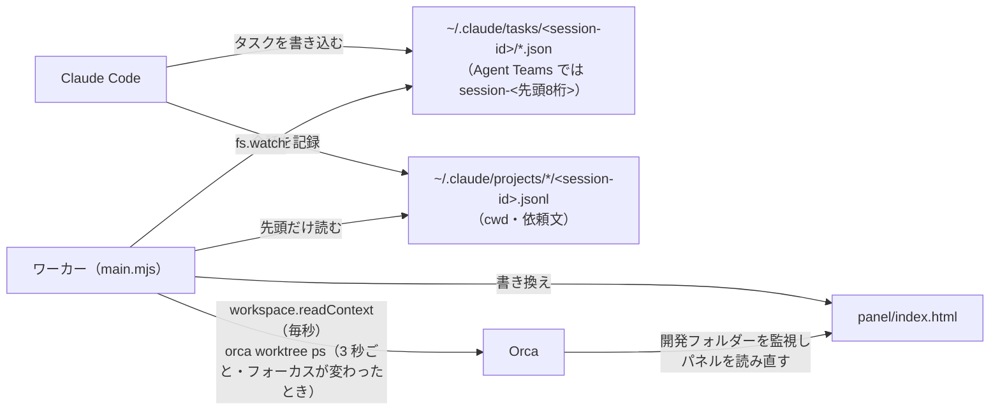

# orca-milestone

[Orca](https://github.com/stablyai/orca) の plugin です。フォーカス中のワークスペースで Claude Code が進めているタスクを、ゴールまでのマイルストーンとして右サイドバーに表示します。タスクが進むと、数秒以内に表示が変わります。

> [!WARNING]
> Orca の plugin 機能は Alpha です。この plugin は Orca 1.4.245 以上を対象にしており、**開発フォルダーとして読み込んだときだけ**表示がリアルタイムに更新されます（[仕組み](#仕組み)）。

<p>
  
  
</p>

左が通常の表示、右がほかのワークスペースの行にマウスを乗せたときです（ワークスペース名やタスクはすべてダミーデータです）。

## できること

- 右サイドバーの旗アイコン（**Milestones**）に、フォーカス中のワークスペースの Claude セッションごとに次を表示します（新しい順に最大 3 件）。
  - 今のゴール。次の順で決めます。
    1. Claude がタスクに書いたゴール（`metadata.goal`）。いちばん新しいタスクのものを使い、ほかのゴールのタスクは表示しません。
    2. 一覧の最初のタスクを作る直前に送った依頼文
    3. セッションの最初の依頼文
  - 完了したタスク数と進捗バー
  - タスクの一覧（✓ 完了・● 進行中・○ 未着手）
- ワークスペースを切り替えると、表示もそのワークスペースのものに変わります。
- パネルの下端に「ほかのワークスペース」として、Orca で動いているほかの Claude を並べます（最大 8 件）。
  - 要確認（入力待ち・許可待ち）のものを先頭に、オレンジの「要確認」を付けて出します。次に、タスクが残っているもの、すべて完了したものの順に、それぞれタスクが新しく動いた順で出します。作業中かどうかは出しません（ターンごとに変わり、そのたびにパネルが作り直されるため）。
  - 各行は、印（要確認はオレンジの点、タスクがすべて完了したものは緑のチェック、ほかはグレーの点）、ワークスペース名（横に小さくプロジェクト名）と、いちばん新しいタスク一覧の進捗バー・完了数です。行にマウスを乗せると、ワークスペース名・ゴール・タスクの一覧が行の上に重なって出ます。
  - 行をクリックしてそのワークスペースへ移ることはできません（パネルから Orca を操作する API がないため）。
- タスク一覧は、その Claude セッションが動いている間だけ表示します。セッションを終了したり、ワークスペースを削除したりすると消えます。動いているセッションは、Claude が `~/.claude/sessions/<pid>.json` に書く情報で判断します。
- Claude はすべてのタスクを完了するとタスク一覧のファイルを消しますが、この plugin はセッションが動いている間、完了した状態のまま表示を残します。plugin を再起動した後も、transcript に残る TaskCreate / TaskUpdate の記録から組み立て直します。
- 対象は Claude Code だけです。Orca の Agent Teams で起動した Claude（`claude --teammate-mode`）にも対応しています。

## 必要なもの

- Orca 1.4.245 以上（macOS で確認）
- Node.js 24 以上（初回のセットアップに使います）
- Claude Code がタスクを作ること。Opus 4.7・Sonnet 4.6 より新しいモデルでは、Claude Code はタスク用のツールを既定で使いません。`~/.claude/settings.json` に次を加えると、新しく起動するセッションから使います。

  ```json
  { "env": { "CLAUDE_CODE_ENABLE_TODO_TOOLS": "1" } }
  ```

## インストール

1. clone して、パネルの初期ファイルを作ります。

   ```sh
   git clone https://github.com/andoshin11/orca-milestone.git
   cd orca-milestone
   npm run setup
   ```

   Orca はパネルのファイルがない plugin を読み込まないため、最初の 1 回だけ必要です（`npm install` でも作られます）。
2. Orca の **Settings → Plugins → ⋯ → Development folders…** で、clone したフォルダーを追加します。
3. 一覧の「Milestone」で **確認** を押し、有効にします。Node のワーカーを動かすため、フルアクセスの plugin として承認を求められます。host API で使う権限は、ワークスペースの名前・ブランチの読み取りと Agent ステータスの通知です。
4. 右サイドバーの旗アイコンを開きます。表示が空のままなら、コマンドパレットで **Milestone: Refresh** を実行します（ワーカーは最初のコマンドかイベントで起動します）。

## Claude にゴールを書かせる

同じセッションでゴールが変わっても見出しが追従するよう、`~/.claude/CLAUDE.md` などで、タスクにゴールを付けるよう Claude に指示しておくのがおすすめです。

```markdown
- 作業を始めるときは TaskCreate で手順をタスクにし、どのタスクにも `metadata: {"goal": "<今の依頼で目指していることを 1 行で>"}` を付ける。
- ゴールが変わったら、前のゴールの未完了タスクを completed か deleted にしてから、新しいゴールを付けたタスクを作る。
```

## 表示されないとき

- パネルに「このワークスペースの Claude はまだタスクを作っていません」と出る場合、Claude がタスクを作っていません。タスクを作るかどうかは Claude が作業の大きさで決めるため、短い作業では作らないこともあります。進捗を出したいときは「タスクに分けて進めて」と頼むと作ります。
- 設定を加える前から動いている Claude セッションでは、タスク用のツールが使えないことがあります。新しく起動し直してください。

## 仕組み



- Orca の plugin パネルは、ワーカーからデータを受け取れません（CSP が `connect-src 'none'` で、ワーカーとの通信路もありません）。そのため、ワーカーがパネルの HTML ファイルそのものを書き換えます。
- Orca は開発フォルダーを監視していて、ファイルが変わるとパネルの HTML を読み直し、内容が違えばパネルを作り直します。Git URL やカタログからのインストールでは、この更新は起きません。
- パネルは更新のたびに作り直されるため、スクロール位置は保たれません。内容が変わったときだけ書き換えます。
- Agent Teams を率いる Claude は、タスク一覧をチーム名（`session-<セッション ID の先頭 8 桁>`）のフォルダーに書きます。どのセッションのものかは、`~/.claude/teams/<チーム名>/config.json` のリーダーのセッション ID か、なければ先頭 8 桁が一致する transcript で決めます。
- フォーカス中のワークスペースのパスは、`workspace.readContext` が返さないため、Orca に同梱の CLI（`orca worktree ps`）で調べます。セッションは、transcript に記録された作業ディレクトリがそのパスの中にあるものを表示します。
- ほかのワークスペースの Agent の状態は、ワーカーに届くイベントがないため、3 秒ごとに `orca worktree ps` で取り直します（1 回 0.1〜0.2 秒）。パネルは、表示する内容が変わったときだけ書き換えます。Orca は書き換えのたびにパネルの枠を作り直し、一瞬空になるため、書き換えは最短 5 秒おきにまとめます。ほかのワークスペースへフォーカスを移したときは、すぐに書き換えます。

## 開発

```sh
npm ci
npm test

# Orca 本体の parser で orca-plugin.json を検証する（stablyai/orca の checkout が必要）
ORCA_SOURCE_DIR=/path/to/orca npm run check:manifest
```

README のスクリーンショットは、ダミーデータでパネルを描いたページから撮っています。

```sh
node scripts/render-sample.mjs /tmp/sample.html          # 通常の表示
node scripts/render-sample.mjs /tmp/sample-hover.html --hover   # 行にマウスを乗せたとき
```

ワーカーのコードを変えたら、Settings → Plugins で Milestone をいったんオフにしてからオンに戻すと、新しいコードで起動します。CI では `engines.orca` と同じ Orca のタグ（v1.4.245）を取得して、manifest を検証します。

## ライセンス

[MIT](LICENSE)
